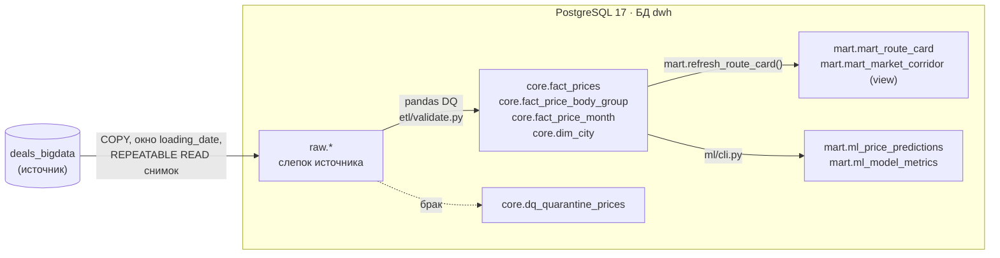
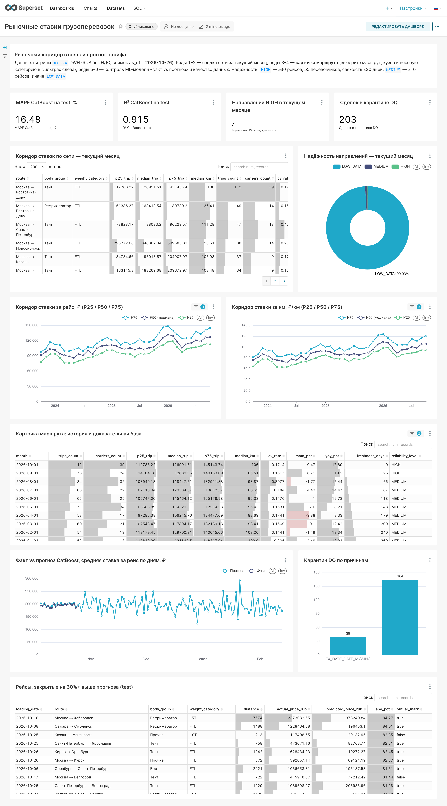

# Smart Logistics: рыночные ставки и прогноз тарифов (ETL → DWH → ML)

Прототип платформы данных для сервиса ставок «Умной Логистики»: идемпотентный ETL с Data Quality,
витрина «Карточка маршрута и коридор рыночных ставок» и ML-прогноз тарифа с batch-скорингом.
Условие задания — [docs/TASK.md](docs/TASK.md).

## Быстрый старт

**Требования:** Docker с Docker Compose **v2.24+** (`docker compose version`). Старый `docker-compose` v1 на Python
не поддерживает необязательный `env_file` (`required: false`). Около 2 ГБ свободной памяти для обязательной части.

```bash
docker-compose up          # или: docker compose up
```

Что произойдёт:

1. `postgres` (PostgreSQL 17) при первом старте создаёт БД источника `deals_bigdata` и хранилища `dwh`, разворачивает
   `sql/schema.sql` и генерирует 300 000 сделок `sql/synthetic.sql` (детерминированный seed).
2. `pipeline` ждёт healthcheck и выполняет [`scripts/run_all.sh`](scripts/run_all.sh):
   миграции DWH, ETL с DQ-валидацией и загрузкой в `core`, пересчёт витрины, обучение моделей и batch-скоринг.
3. Контейнер `pipeline` завершается с кодом 0: в логе появится `pipeline-1 exited with code 0`.

Прогон с нуля на пустых volume занимает около минуты, без учёта загрузки образов. Результаты детерминированы: повторный прогон с нуля даёт те же суммы и те же метрики до копейки.

После завершения пайплайна команда `docker-compose up` **не выходит сама**: PostgreSQL остаётся доступен на `localhost:5432`
(пользователь и пароль заданы в `.env.example`), чтобы можно было смотреть витрины. Остановить — `Ctrl+C`; запуск в фоне — `docker-compose up -d`.

Своя конфигурация задаётся через `cp .env.example .env`: `.env` переопределяет демо-значения. Порт хоста меняется переменной `PG_HOST_PORT`.

Бонусные Airflow и Superset вынесены в профили и обычным `up` не запускаются, чтобы обязательная часть оставалась лёгкой.
Чтобы `docker-compose up` поднимал всё сразу, добавьте в `.env` строку ниже. Понадобится ещё ~3 ГБ памяти.

```bash
COMPOSE_PROFILES=airflow,superset
```

```bash
docker compose --profile test run --rm tests       # pytest: 50 unit + 7 интеграционных против поднятого DWH
docker compose run --rm pipeline                   # повторный полный прогон (идемпотентен)
docker compose down -v                             # снести всё вместе с данными
```

## Архитектура



| Слой | Содержимое | Как обновляется |
|---|---|---|
| `raw` | `prices`, `price_body_types`, `price_dates` (окно), `cities`, `body_types`, `exchange_rates` (целиком) | staging + `DELETE окна` + `INSERT`, дочерние таблицы чистятся каскадом |
| `core` | очищенные факты в RUB, мосты «сделка × группа кузова» и «сделка × месяц», дедуплицированные города, карантин, журнал `etl_runs` | `DELETE окна` + `INSERT` в одной транзакции |
| `mart` | карточка маршрута, срез последнего месяца, прогнозы и метрики ML | SQL-функция пересчитывает месяцы, начиная с окна; ML-результаты: `DELETE`/`COPY` и `UPSERT` |

`price_group_stats` в DWH не извлекается. Витрине он не нужен, а для ML это прямая утечка таргета.

### Структура репозитория

```
docker-compose.yml, .env.example, requirements.txt
docker/app/Dockerfile                       образ пайплайна (Python 3.11)
docker/postgres/initdb/01_init_source.sh    создание БД + генерация источника
docker/airflow/                             образ и entrypoint Airflow (бонус)
dags/rates_pipeline.py                      DAG Airflow (бонус)
docker/superset/                            образ, init и дашборд-как-код Superset (бонус)
sql/schema.sql, sql/synthetic.sql           источник (из задания)
sql/dwh/0xx_*.sql                           идемпотентные DDL raw/core/mart + функция витрины
etl/                                        extract -> validate (DQ) -> load core -> refresh marts, CLI
ml/                                         признаки, time split, модели, batch-скоринг
tests/unit, tests/integration               pytest
scripts/run_all.sh                          сквозной прогон
```

### Обоснование стека

* **PostgreSQL 17**: обязательное хранилище. На 300 000 сделок все витрины считаются за секунды, поэтому ClickHouse не понадобился.
* **ELT + Python**. Тяжёлые трансформации (мосты, перцентили, MoM/YoY) выполняются в SQL прямо в БД. DQ и FX вынесены в чистые функции pandas: их удобно покрывать юнит-тестами без БД. Все записи идут через `COPY`, построчных `INSERT` нет.
* **Оркестрация**. Базовый запуск — shell-скрипт с CLI-шагами (`python -m etl.cli ...`). Бонус — DAG в Apache Airflow поверх тех же шагов (раздел [Airflow](#бонус-apache-airflow)). Каждый шаг параметризован окном дат и идемпотентен, поэтому оркестратор логику не дублирует.
* **CatBoostRegressor**: нативно работает с категориями (регионы, города, кузов), не требует масштабирования и показал лучший результат в R&D-отчёте. `Ridge` используется как линейный бейзлайн.

## Вопрос 1: ETL и Data Quality

```bash
# загрузка/перезагрузка окна по loading_date (включительно)
docker compose run --rm pipeline python -m etl.cli run --start-date 2026-09-01 --end-date 2026-09-30
# только витрины, начиная с месяца
docker compose run --rm pipeline python -m etl.cli marts --month-from 2026-09-01
```

Без параметров берутся `ETL_START_DATE`/`ETL_END_DATE`; если и они пусты, загружается весь диапазон источника.

**Правила отбраковки** ([etl/validate.py](etl/validate.py)). Строка уходит в `core.dq_quarantine_prices` вместе с основной причиной `reason_code`, полным списком сработавших правил `reason_codes[]` и исходной строкой в `payload jsonb`.

| Код | Условие |
|---|---|
| `PRICE_NON_POSITIVE` | `price <= 0` |
| `RUB_PRICE_BELOW_MIN` | `currency_code = 643` и `price <= 1000` |
| `DISTANCE_NON_POSITIVE` | `distance <= 0` |
| `WEIGHT_NEGATIVE` / `VOLUME_NEGATIVE` | `total_weight < 0` / `total_volume < 0` |
| `LOADING_CITY_UNKNOWN` / `UNLOADING_CITY_UNKNOWN` | `gc_id` нет в `cities` |
| `CURRENCY_UNSUPPORTED` | валюта не из 643/840/978 |
| `FX_RATE_DATE_MISSING` | 840/978 и `nearest_rate_date IS NULL` |
| `FX_RATE_NOT_FOUND` | 840/978 и нет курса ЦБ ровно на `nearest_rate_date` (fallback по `loading_date` не делается) |

* **FX**: `price_rub = price × курс ЦБ на nearest_rate_date`. Для RUB курс равен 1, дата курса не требуется.
* **Категории**: пустые `weight_category` и `volume_category` заполняются по весу, округлённому до 0.1 т. Округление «половина от нуля», как `round(numeric)` в PostgreSQL. Заполненные строки помечены флагами `*_filled`.
* **Не считается браком**: `loading_city_gcid = unloading_city_gcid` (production-джоб такие пары сохраняет), а также `outlier_mark`, `complex` и `price_type = 6`. Это фильтры витрины и ML, поэтому такие строки остаются в `core`.
* **Идемпотентность**: каждая загрузка окна — одна транзакция (`DELETE` окна и id батча, затем `INSERT`), конкурентные запуски сериализуются advisory-lock. Ловятся и сделки, у которых сдвинулся `loading_date`. Тест `test_rerun_window_is_idempotent` сравнивает count, суммы и перцентили до и после двух повторных прогонов.

**Результат на датасете**: прочитано 300 000 строк, в `core` 299 797, в карантине 203: `PRICE_NON_POSITIVE` 164 и `FX_RATE_DATE_MISSING` 39. Правило `RUB_PRICE_BELOW_MIN` сработало 156 раз, но каждый раз вместе с `price = 0`: генератор не создаёт RUB-ставок в диапазоне `(0; 1000]`. Пустых категорий в синтетике нет (`*_filled = 0`), правило заполнения покрыто юнит-тестами.

> **Ограничение данных.** Сделки, созданные в день снимка (`2026-10-26`), ещё не прошли ночной джоб разметки аномалий: у них `outlier_mark = false` по умолчанию. Поэтому в октябрьских ячейках витрины и в последнем дне `test` возможны неотфильтрованные выбросы. Флаг используется как есть, без пересчёта. Пересчёт по аналогии с `MarkOutlierPrices` (группа `price_group_id` от 4 строк, IQR по сырому `price`, P5–P95 по `price_km`) — возможное улучшение, в базовое решение не входит.

## Вопрос 2: витрина «Карточка маршрута и коридор ставок»

Логика пересчёта — функция `mart.refresh_route_card(month_from, as_of)` в [sql/dwh/030_mart_route_card.sql](sql/dwh/030_mart_route_card.sql). Её вызывает пайплайн, но её можно запустить и вручную: `SELECT mart.refresh_route_card('2023-10-01', '2026-10-26');`.

* **Grain**: `month` (из `price_dates.price_date`) × `loading_city_gcid` × `unloading_city_gcid` × `body_group` × `weight_category`. `volume_category_mode` хранится только как атрибут.
* **Дедупликация городов**: `core.dim_city` содержит одну строку на `gc_id` с минимальным `cities.id`. Город и регион разобраны из `full_name_local` (`'Казань, Республика Татарстан'` → `Казань` / `Республика Татарстан`).
* **Группы кузова**: `core.fact_price_body_group` хранит одну строку на пару (сделка, группа), для этого используется PK. Сделка с «Тент + Борт» попадает в обе группы, но внутри одной группы учитывается один раз (12% сделок имеют 2 кузова, дочерние коды 57/46/1 корректно сводятся к своим группам). Если в `price_body_types` нет строк, используется `prices.body_type`, затем значение «Не указан».
* **Фильтр**: `is_fact`, `price_type IN (1,2,3,4,5,9)`, `NOT complex`, `price > 0`, `distance > 0`, `NOT outlier_mark`, `price_date <= as_of`.
* **Метрики**: `p25/median/p75/avg_trip`, `p25/median/p75_km`, `trips_count`, `carriers_count` (`price_type IN (3,9)`), `cv_rate` (NULL при n < 2 или среднем 0), `mom_pct` / `yoy_pct` (только строго календарный предыдущий месяц или год назад, иначе NULL), `reliability_level`.
* **Свежесть для `HIGH`**: `freshness_days = as_of − last_trip_date`, где `last_trip_date` — максимальный `price_date` в ячейке. Значит, `HIGH` возможен только у ячеек со сделками за последние 30 дней. Остальные получают не выше `MEDIUM` — это сознательная интерпретация.
* **Инкрементальность**: у всех сделок окна `price_date >= loading_date >= start`, поэтому пересчёт хвоста `[month(start); …]` покрывает все затронутые месяцы, а MoM/YoY пересчитываются после вставки.
* `mart.mart_market_corridor` — view последнего месяца для сводного анализа маршрутной сети.

Итог: 203 644 ячейки (HIGH 10, MEDIUM 924, остальные LOW_DATA). Распределение ожидаемо для 1 600 направлений × 6 групп кузова × 6 весовых категорий × 37 месяцев.

### Примеры запросов

```sql
-- Сводная таблица сети за текущий месяц: самые надёжные направления
SELECT loading_city, unloading_city, body_group, weight_category,
       p25_trip, median_trip, p75_trip, median_km, trips_count, carriers_count, mom_pct, yoy_pct, reliability_level
FROM mart.mart_market_corridor
ORDER BY trips_count DESC
LIMIT 20;

-- Детальная карточка маршрута: помесячная история коридора
SELECT month, p25_trip, median_trip, p75_trip, p25_km, median_km, p75_km,
       trips_count, carriers_count, cv_rate, mom_pct, yoy_pct, reliability_level
FROM mart.mart_route_card
WHERE loading_city_gcid = 1001 AND unloading_city_gcid = 1008   -- Москва → Ростов-на-Дону
  AND body_group = 'Тент' AND weight_category = 'FTL'
ORDER BY month;

-- Отчёт DQ
SELECT reason_code, count(*) FROM core.dq_quarantine_prices GROUP BY 1 ORDER BY 2 DESC;
```

Пример результата (топ `HIGH`):

| month | route | body | wc | trips | carriers | P50, ₽/рейс | P25–P75, ₽/км | MoM % | YoY % |
|---|---|---|---|---|---|---|---|---|---|
| 2026-10 | Москва → Ростов-на-Дону | Тент | FTL | 112 | 39 | 126 991.51 | 94.15–121.16 | 0.47 | 17.69 |
| 2026-10 | Москва → Ростов-на-Дону | Рефрижератор | FTL | 49 | 14 | 163 418.54 | 126.37–150.87 | 5.17 | 9.98 |
| 2026-10 | Москва → Санкт-Петербург | Тент | FTL | 47 | 18 | 88 023.20 | 99.66–121.66 | 0.09 | 18.34 |

## Вопрос 3: ML-прогноз тарифа

Код: [ml/features.py](ml/features.py), [ml/models.py](ml/models.py), [ml/cli.py](ml/cli.py).

* **Популяция**: `core.fact_prices` (DQ пройден, `price_rub` посчитан), `is_fact`, `NOT complex`. Таргет `price_rub` очищается по `outlier_mark`, но сам флаг в признаки не входит.
* **Признаки**:
  * регионы и города отправления/назначения кодируются раздельно (не склеенный маршрут), плюс координаты из `dim_city`;
  * `distance`, `total_weight`, `total_volume`, `body_group`, весовая и объёмная категории;
  * `year`, `month`, `day_of_week`, `day_of_year` и sin/cos для периодов 12, 7 и 365.25.
* **Защита от утечек**:
  * `assert_no_leakage` запрещает `price*`, `price_with_vat`, удельные тарифы, маржу и прибыль, `price_group_stats.*` и `outlier_mark`;
  * импутеры, one-hot и скейлер Ridge фитятся внутри `Pipeline` только на train;
  * у CatBoost нет early stopping по test, число итераций фиксировано.
* **Time split** (от `as_of = 2026-10-26`, не от системной даты): train `[2026-07-26; 2026-10-05)`, test `[2026-10-05; 2026-10-26]`, future `> 2026-10-26`. Без shuffle.
* **Воспроизводимость**: `RANDOM_SEED` для `random`, `numpy`, CatBoost и Ridge.

### Метрики на test (12 808 сделок, train 24 226)

| Модель | R² | MAPE, % | RMSE, ₽ | MAE, ₽ |
|---|---:|---:|---:|---:|
| **CatBoostRegressor** (`catboost_v1`) | **0.9146** | **16.48** | **55 890.63** | **29 173.31** |
| Ridge (`ridge_baseline`) | 0.8405 | 49.44 | 76 407.98 | 48 308.95 |

Важность признаков CatBoost: `distance` 57%, `total_weight` 10%, `weight_category` 10%, `body_group` 8%, далее география. Соотношение моделей совпадает с R&D-отчётом. Абсолютный MAPE выше, чем в отчёте, по двум причинам: в синтетике заложен лог-нормальный шум ≈16%, а в test попадают неразмеченные выбросы за `2026-10-26`.

### Batch-скоринг

`mart.ml_price_predictions` содержит 35 938 строк: 2 модели × (13 078 test + 4 891 future). Колонки: `price_id`, `model_name`, `split`, `loading_date`, коды городов, `body_group`, `actual_price_rub`, `predicted_price_rub`, `abs_error_rub`, `ape_pct`, `outlier_mark`, `as_of`, `scored_at`.

* У будущих заявок `actual_price_rub`, `abs_error_rub` и `ape_pct` равны `NULL`, даже если `price` в источнике заполнен. Это гарантирует CHECK-constraint.
* Скоринг test-периода включает и размеченные выбросы. Они нужны для сценария «рейсы, закрытые сильно выше прогноза», но в расчёт метрик не входят.

```sql
-- Рейсы, закрытые существенно выше прогноза рынка
SELECT price_id, loading_date, loading_city_gcid, unloading_city_gcid, body_group,
       actual_price_rub, predicted_price_rub, ape_pct
FROM mart.ml_price_predictions
WHERE model_name = 'catboost_v1' AND split = 'test' AND actual_price_rub > predicted_price_rub * 1.3
ORDER BY ape_pct DESC LIMIT 20;

-- Метрики моделей
SELECT model_name, r2, mape_pct, rmse_rub, mae_rub, n_train, n_test FROM mart.ml_model_metrics;
```

## Тесты

* `tests/unit`: все DQ-правила и коды причин, курсы, границы весовых и объёмных категорий (10.0, 30.0, 29.96, 0.45, 120 м³), границы time split (`2026-10-05` попадает только в test), циклическое кодирование на стыке года, запрет утечек.
* `tests/integration`:
  * идемпотентность повторного прогона окна;
  * отсутствие дублей и пересечения `core` с карантином, DQ-инварианты в `core`;
  * маппинг кузовов, правила `reliability_level`, `cv_rate` и MoM;
  * сверка ячейки витрины с прямым расчётом по `core`;
  * пустые факты у future-прогнозов.

## Бонус: Apache Airflow

```bash
docker compose --profile airflow up -d airflow-webserver airflow-scheduler
# UI: http://localhost:8080  (логин/пароль: AIRFLOW_ADMIN_USER / AIRFLOW_ADMIN_PASSWORD из .env.example)
```

Airflow вынесен в отдельный профиль, поэтому обязательный `docker-compose up` остаётся лёгким.

* **Как устроен**: Airflow 2.10, LocalExecutor, метаданные в отдельной БД `airflow` того же PostgreSQL. Её при старте создаёт [docker/airflow/entrypoint.sh](docker/airflow/entrypoint.sh).
* **Изоляция зависимостей**: код пайплайна стоит в отдельном venv внутри образа ([docker/airflow/Dockerfile](docker/airflow/Dockerfile)), поэтому pandas/catboost/psycopg 3 не конфликтуют с constraints Airflow.
* **Где логика**: DAG [dags/rates_pipeline.py](dags/rates_pipeline.py) — тонкая обёртка над теми же CLI-шагами, что и в базовом запуске, своей логики в нём нет.

```
migrate_dwh -> load_month_to_core -> refresh_route_card ----------------------> train_and_score
                                  \-> latest_only -> load_future_plans ------/
```

* **Расписание и окно**: `@monthly`, окно запуска = data interval, то есть `loading_date ∈ [data_interval_start; data_interval_end)`.
* **История**: `catchup=True` с `2023-10-01` догружает 37 месяцев по одному. `max_active_runs=1` гарантирует, что хвост витрины пересчитывается по порядку.
* **Будущие заявки и ML** выполняются только в последнем запуске (`LatestOnlyOperator`), чтобы backfill истории не переобучал модель 37 раз.
* **Повторный запуск** (`Clear` задачи или backfill периода) идемпотентен. После полного catchup поверх данных базового пайплайна суммы в `core`, `mart` и прогнозах совпадают до копейки.
* **Дата снимка**: `as_of` берётся из `AS_OF`, а не из системной даты, потому что датасет — фиксированный снимок. В production это было бы `data_interval_end - 1 день`.

```bash
# перезагрузить конкретный период через Airflow
docker compose --profile airflow exec airflow-scheduler \
  airflow dags backfill smart_logistics_rates -s 2026-09-01 -e 2026-09-30 --reset-dagruns -y
```

## Бонус: Apache Superset

```bash
docker compose --profile superset up -d superset
# UI: http://localhost:8088/superset/dashboard/freight-rates/
# логин/пароль: SUPERSET_ADMIN_USER / SUPERSET_ADMIN_PASSWORD из .env.example
```

Superset вынесен в отдельный профиль: обязательный `docker-compose up` его не запускает.

**Как устроено**

* Superset 4.1. Его метаданные (дашборды, чарты, пользователи) лежат в SQLite на volume — для локального демо этого достаточно.
* Подключение к `dwh`, датасеты, чарты и дашборд создаются кодом в [docker/superset/bootstrap_dashboard.py](docker/superset/bootstrap_dashboard.py), руками в UI ничего собирать не нужно.
* `superset-init` ждёт успешного завершения `pipeline`, поэтому датасеты строятся поверх уже готовых витрин.
* Повторный init пересоздаёт дашборд из кода без дублей. Строка подключения собирается из `POSTGRES_*`, пароль нигде не дублируется.

**Что на дашборде «Рыночные ставки грузоперевозок»**

| Ряд | Содержимое | Сценарий из `meeting-summary.md` |
|---|---|---|
| 1 | KPI: MAPE и R² CatBoost, число направлений `HIGH` в текущем месяце, строк в карантине DQ | — |
| 2 | Таблица коридоров по всей сети за текущий месяц (P25/P50/P75, ₽/км, рейсы, перевозчики, MoM/YoY, надёжность) и донат распределения `reliability_level` | сводный анализ для тендеров |
| 3–4 | Карточка маршрута: помесячный коридор ₽/рейс и ₽/км, история с доказательной базой | детальная карточка для спота |
| 5 | Факт vs прогноз CatBoost по дням: для test-периода есть факт, для будущих заявок — только прогноз; рядом карантин DQ по причинам | пост-анализ «факт vs прогноз» |
| 6 | Рейсы, закрытые на 30%+ выше прогноза | подсветка отклонений |

Для карточки маршрута (ряды 3–4) есть нативные фильтры «Маршрут», «Группа кузова» и «Весовая категория». По умолчанию выбрано Москва → Ростов-на-Дону, Тент, FTL. На остальные чарты фильтры не действуют.

Dashboard Superset


